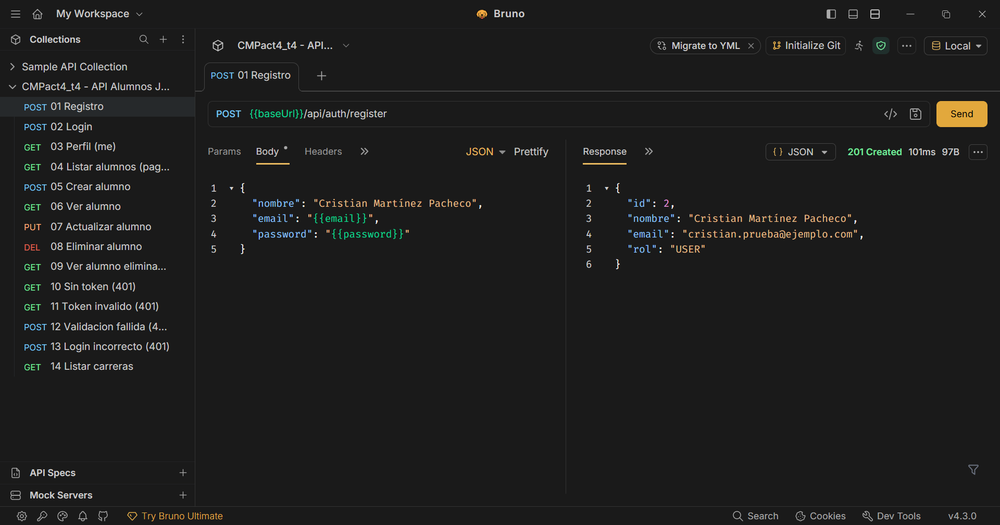
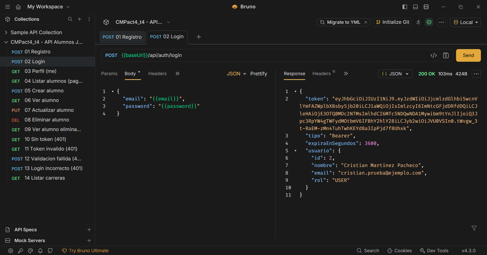
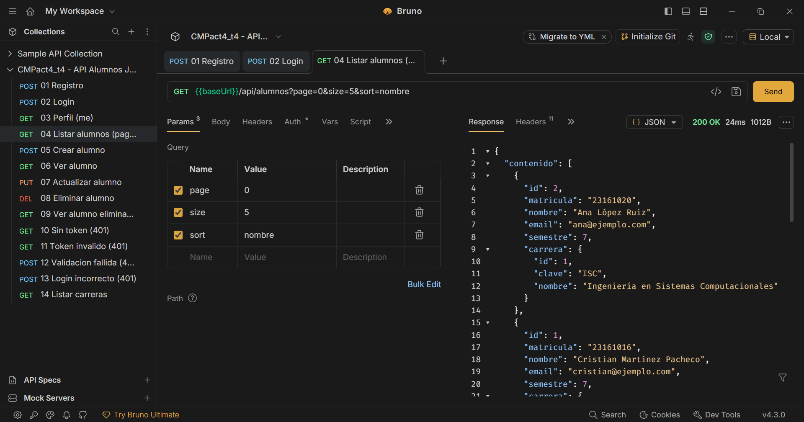
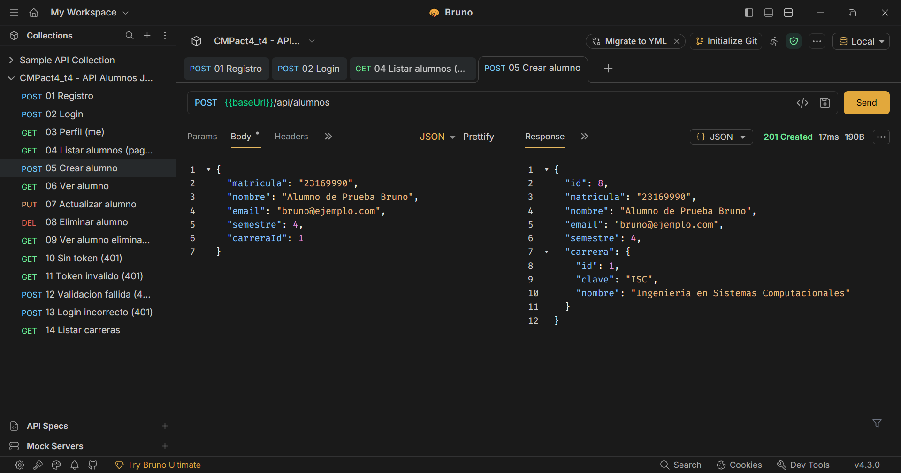
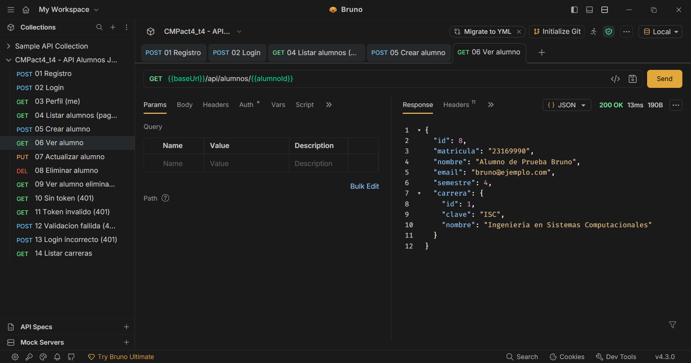
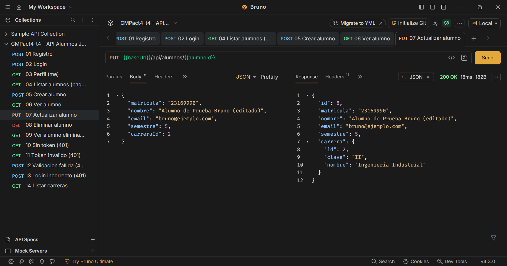
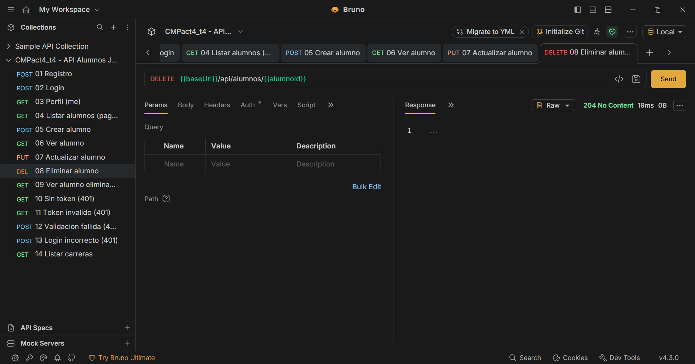
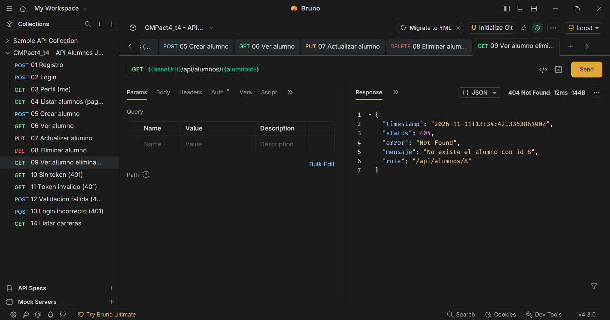
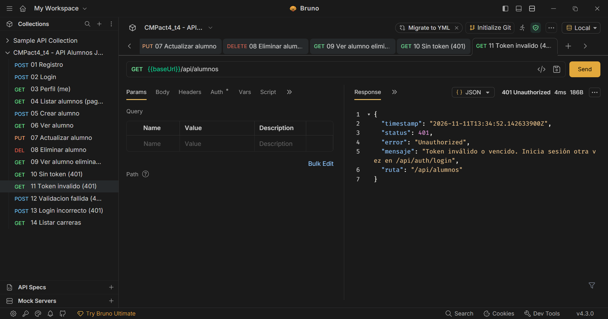
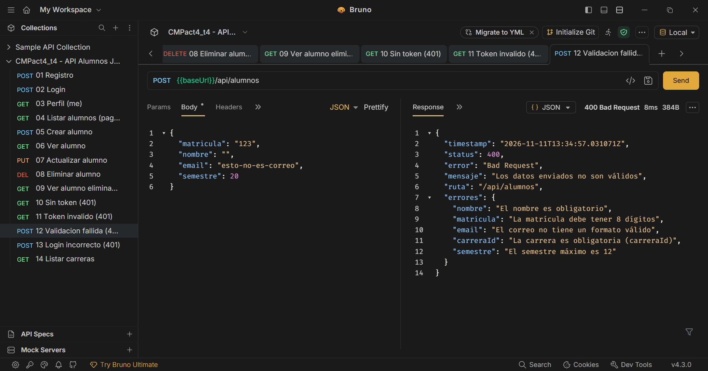

# CMPact4_t4

Actividad 4, Tema 4: API REST pura con Spring Boot, **Spring Security y JWT**, conectada a MySQL y probada con **Bruno**.

**Alumno:** Cristian Martínez Pacheco · Matrícula 23161016 · Grupo 7SC

## Tecnologías
- Spring Boot 4.1.2 (Java 21)
- Spring Web, Spring Data JPA, MySQL Driver
- Spring Security + OAuth2 Resource Server (validación de JWT) + Nimbus JOSE (firma HS256)
- Bean Validation (`@Valid`, `@NotBlank`, `@Email`, `@Size`, `@Pattern`, `@Min`, `@Max`)
- Bruno para probar y documentar la API

## Cómo funciona la autenticación

```
1. POST /api/auth/register  →  crea el usuario (password cifrado con BCrypt)
2. POST /api/auth/login     →  valida correo y contraseña, regresa un JWT firmado (válido 1 hora)
3. Peticiones protegidas    →  header  Authorization: Bearer <token>
                               Spring Security valida la firma, la expiración y el emisor del token.
                               Sin token o con un token inválido → 401 Unauthorized
```

El token contiene estos *claims*:

```json
{
  "iss": "cmpact4_t4",
  "sub": "cristian.prueba@ejemplo.com",
  "iat": 1794403549,
  "exp": 1794407149,
  "uid": 1,
  "nombre": "Cristian Martínez Pacheco",
  "rol": "USER"
}
```

## Endpoints

| Método | Ruta | Acceso | Respuestas |
|---|---|---|---|
| GET | `/api` | Público | 200 (descripción de la API) |
| POST | `/api/auth/register` | Público | **201**, 400 (validación), 409 (correo repetido) |
| POST | `/api/auth/login` | Público | **200** con token, 400, 401 (credenciales incorrectas) |
| GET | `/api/auth/me` | Token | 200, 401 |
| GET | `/api/alumnos?page=0&size=5&sort=nombre&carreraId=1` | Token | **200** (paginado), 401 |
| GET | `/api/alumnos/{id}` | Token | **200**, 404, 401 |
| POST | `/api/alumnos` | Token | **201** + header `Location`, 400, 404 (carrera), 409 (matrícula), 401 |
| PUT | `/api/alumnos/{id}` | Token | **200**, 400, 404, 409, 401 |
| DELETE | `/api/alumnos/{id}` | Token | **204**, 404, 401 |
| GET | `/api/carreras` | Token | 200, 401 |

Todos los errores regresan JSON con el mismo formato:
```json
{
  "timestamp": "2026-11-11T13:34:57.031071Z",
  "status": 400,
  "error": "Bad Request",
  "mensaje": "Los datos enviados no son válidos",
  "ruta": "/api/alumnos",
  "errores": {
    "matricula": "La matrícula debe tener 8 dígitos",
    "email": "El correo no tiene un formato válido"
  }
}
```

## DTOs

Las entidades (`Usuario`, `Alumno`, `Carrera`) nunca salen en las respuestas; la API recibe y regresa DTOs:

| DTO | Uso |
|---|---|
| `RegisterRequest` / `LoginRequest` | Entrada de registro y login, con validación |
| `UsuarioResponse` | Datos públicos del usuario: **no incluye el password** |
| `AuthResponse` | Token, tipo (`Bearer`), expiración y usuario |
| `AlumnoRequest` | Entrada de POST/PUT, con validación |
| `AlumnoResponse` / `CarreraResponse` | Salida del alumno con su carrera (relación `@ManyToOne`) |
| `PaginaResponse<T>` | Lista paginada: contenido, página, tamaño, total de elementos y páginas |

## Estructura

```
src/main/java/com/example/cmpact4_t4/
├── security/    SecurityConfig (filtros, JWT encoder/decoder, BCrypt), JwtService, JsonAuthenticationEntryPoint (401 JSON)
├── controller/  AuthController, AlumnoController, InicioController
├── service/     AuthService, AlumnoService
├── repository/  UsuarioRepository, AlumnoRepository, CarreraRepository (JpaRepository)
├── entity/      Usuario, Alumno, Carrera
├── dto/         AuthDtos, AlumnoDtos, ErrorResponse
├── exception/   ManejadorErrores (@RestControllerAdvice), excepciones 404 y 409
└── config/      DatosIniciales (carreras y alumnos de ejemplo)
bruno/           Colección de Bruno (14 peticiones + ambientes Local y VPS)
```

## Colección de Bruno

La carpeta [`bruno/`](bruno) es la colección completa. En Bruno: **Open Collection** → selecciona la carpeta `bruno`, y elige el ambiente **Local** o **VPS**.

| # | Petición | Resultado esperado |
|---|---|---|
| 01 | Registro | 201 (o 409 si ya existe) |
| 02 | Login | 200 + guarda `{{token}}` |
| 03 | Perfil (me) | 200 |
| 04 | Listar alumnos (paginado) | 200 |
| 05 | Crear alumno | 201 + guarda `{{alumnoId}}` |
| 06 | Ver alumno | 200 |
| 07 | Actualizar alumno | 200 |
| 08 | Eliminar alumno | 204 |
| 09 | Ver alumno eliminado | 404 |
| 10 | **Sin token** | **401** |
| 11 | Token inválido | 401 |
| 12 | Validación fallida | 400 |
| 13 | Login incorrecto | 401 |
| 14 | Listar carreras | 200 |

Cada petición tiene pruebas automáticas (`tests`), así que también se puede ejecutar toda la colección con **Run**.

## Capturas de pantalla (Bruno)

### Registro: `POST /api/auth/register` → 201 (sin password en la respuesta)


### Login: `POST /api/auth/login` → 200 con el token JWT


### READ: `GET /api/alumnos?page=0&size=5&sort=nombre` → 200 (paginado, con token)


### CREATE: `POST /api/alumnos` → 201


### READ uno: `GET /api/alumnos/{id}` → 200


### UPDATE: `PUT /api/alumnos/{id}` → 200


### DELETE: `DELETE /api/alumnos/{id}` → 204


Después de eliminarlo, consultarlo da 404:


### Endpoint protegido sin token → 401


### Token inválido → 401


### Validación con `@Valid` → 400 con los errores de cada campo


## Ejecutar en local
1. Crea la base de datos y el usuario de prueba (como root):
   ```bash
   mysql -u root -p < db/crear_bd_local.sql
   ```
2. Ejecuta el proyecto:
   ```bash
   ./mvnw spring-boot:run
   ```
3. La API queda en http://localhost:8084/api

## Configuración y credenciales
`application.properties` toma los datos sensibles de variables de entorno, y solo usa valores de prueba en local si no existen:

| Variable | Uso |
|---|---|
| `DB_URL`, `DB_USER`, `DB_PASSWORD` | Conexión a MySQL |
| `JWT_SECRET` | Clave para firmar los tokens (mínimo 32 caracteres) |
| `JWT_EXPIRACION` | Duración del token en segundos (por defecto 3600) |

En el VPS estas variables están en un archivo `act4.env` que solo existe en el servidor.

## API en el VPS
- URL base: **http://68.155.155.10:8084/api**

Las actividades anteriores siguen corriendo en sus puertos: 8081 (Act. 1), 8082 (Act. 2) y 8083 (Act. 3).
